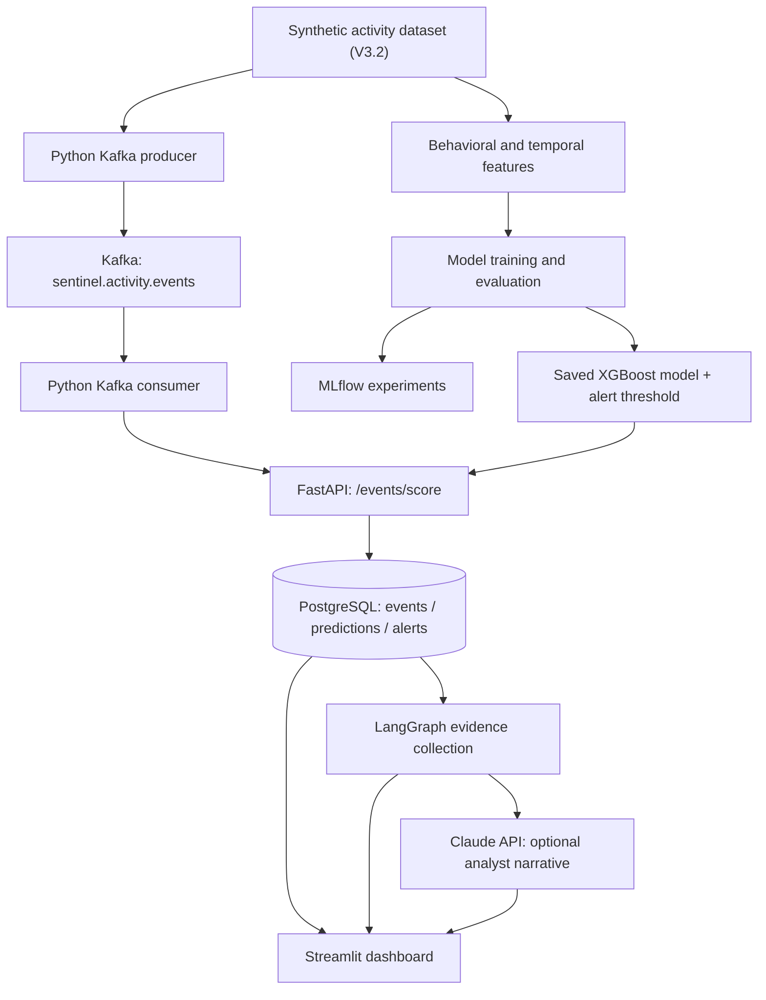

# SentinelAI

**Experimental insider-risk detection and investigation platform** using machine learning, event streaming, and evidence-grounded AI summaries.

> **Portfolio/research prototype.** All currently demonstrated events and labels are **synthetic**. SentinelAI is not validated for operational employee monitoring or for decisions about individuals. A model alert is not proof of wrongdoing.

## What it does

1. Generates synthetic activity from human users and AI agents, including routine actions, approved bulk workflows, and simulated misuse scenarios.
2. Builds temporal and behavioral features and evaluates Logistic Regression, XGBoost, and Isolation Forest.
3. Serves risk predictions through FastAPI.
4. Publishes events to Apache Kafka and consumes them for scoring.
5. Stores events, predictions, and alerts in PostgreSQL.
6. Uses LangGraph to retrieve associated records and assemble an evidence-based investigation report.
7. Optionally uses Claude to generate a readable analyst briefing; the report remains subject to human verification.
8. Displays alerts, activity, and investigation results in a Streamlit dashboard.

## Architecture



**Important current boundary:** Kafka messages contain **precomputed feature values**. FastAPI currently scores these submitted features; it does **not** independently calculate streaming temporal features from raw events. The consumer sends Kafka messages to FastAPI, and duplicate IDs are handled by its demo logic.

## Demonstrated ML results

The selected V3.2 XGBoost model used a validation-selected threshold and was evaluated on a held-out *synthetic* test split:

| Measure | Test result |
| --- | ---: |
| Average precision | 0.3479 |
| Alert threshold | 0.9579067 |
| Test alerts | 86 |
| Precision at threshold | 0.3953 |
| Recall at threshold | 0.3148 |
| Risk-labeled events detected | 34 / 108 |
| Simulated incidents detected | 15 / 26 |
| False-positive alerts | 52 |

The reported false-positive alerts were in simulated approved bulk-operation scenarios. Results depend on the synthetic generator, its labels, and its split design; they **must not** be described as real-world detection performance. A high score is not evidence of actual malicious intent.

## Technology

- **ML:** Python, pandas, scikit-learn, XGBoost, Isolation Forest, MLflow
- **API:** FastAPI, Uvicorn
- **Streaming:** Apache Kafka, `confluent-kafka`
- **Storage:** PostgreSQL 18, Psycopg
- **Investigation:** LangGraph; optional Anthropic Claude API
- **Interface:** Streamlit
- **Local infrastructure:** Docker Desktop

## Local setup (existing working environment)

These commands document the **already-tested local setup**. This repository does not yet include a fully tested one-command deployment. Use your existing running Docker containers; **do not recreate them if they already exist**.

### 1. Activate Python environment

From the project root:

```bash
source .venv/bin/activate
```

Install project dependencies as needed in a fresh environment (see imports in `src/` and the `tests/` directory). A locked, verified dependency manifest is not yet provided.

### 2. Start existing PostgreSQL and Kafka containers (only if stopped)

```bash
docker start sentinel-postgres sentinel-kafka
```

The working local containers listen on `127.0.0.1:5432` and `127.0.0.1:9092`, respectively. The PostgreSQL data volume is named `sentinel_postgres_data`.

If setting up a **new empty database** with an independently provisioned PostgreSQL server, initialize the schema from `sql/schema.sql`. Do **not** rerun initialization blindly against a populated production database.

### 3. Configure environment variables

See `.env.example` for placeholders. For the existing local demonstration, export `DATABASE_URL` in every terminal that directly accesses the database, and `ANTHROPIC_API_KEY` only when generating Claude summaries. Never commit API keys or passwords.

```bash
export DATABASE_URL='postgresql://sentinel:<LOCAL_PASSWORD>@127.0.0.1:5432/sentinel_ai'
export KAFKA_BOOTSTRAP_SERVERS='127.0.0.1:9092'
```

Substitute your actual **local** development password. If Claude is needed, configure `ANTHROPIC_API_KEY` securely in the terminal running Streamlit or the CLI. Each Claude request may consume API credits.

### 4. Start FastAPI

In terminal 1:

```bash
python -m uvicorn src.api:app --reload --reload-dir src --port 8000
```

Open <http://127.0.0.1:8000/docs>. Available endpoints include `GET /health`, `GET /model/info`, `POST /predict`, and `POST /events/score`.

### 5. Launch the dashboard

In terminal 2, with `DATABASE_URL` configured:

```bash
python -m streamlit run src/dashboard.py
```

Open <http://localhost:8501>. Generating an AI investigation from the dashboard requires a valid Claude API key and makes a billable API request; simply viewing the dashboard does not.

### 6. Optional: demonstrate Kafka event flow

The working Kafka topic is `sentinel.activity.events`. The producer publishes five selected synthetic events; the consumer forwards them to FastAPI. **The original demonstration has already consumed these five messages.** Rerunning the producer or consumer may cause duplicate messages or skip committed offsets, so do not expect a fresh five-row insert from every run.

```bash
python src/kafka_producer.py
python src/kafka_consumer.py
```

Run them in sequence and keep FastAPI active. This is a demonstration pipeline, not a hardened at-least-once distributed ingestion service.

## Investigation example

With `DATABASE_URL` exported:

```bash
python -m src.investigation_agent 3
python -m src.claude_investigation 3 --dry-run
```

The dry run **does not** use Claude credits. Without `--dry-run`, the CLI calls Claude. Alert IDs and evidence counts depend on the database contents.

The investigation graph queries stored events from the same actor within a 24-hour window, deduplicates matching synthetic test records for reporting, and assembles an evidence summary. It does not currently verify authorization, business purpose, or a real historical behavior baseline. Identical-looking activity is **not** reliable proof of duplication in real-world telemetry.

## Tests

With FastAPI and PostgreSQL running and `DATABASE_URL` configured:

```bash
python -m tests.test_system_integration
```

The demonstrated local test passed and checked API health, database record counts, and the LangGraph deduplication report. It uses specific seed data and alert ID 3, so it is **not** a clean-install or production-ready automated test suite.

Other tests/scripts may be present under `tests/`; some require prepared synthetic data or running services.

## Demonstrated local outcome

In the successful local demonstration:

- **7** database event rows, **7** saved predictions, and **3** alerts were recorded.
- **5** Kafka messages were delivered and consumed.
- An investigation of alert 3, after synthetic-test deduplication, included **2** distinct activities totaling **145.69 MB**.
- Claude generated a dashboard briefing using the corrected evidence.

These counts are **test-fixture results**, not throughput benchmarks or production scale claims.

## Limitations and responsible use

- Synthetic-only evaluation does not establish efficacy on real employee/AI-agent activity.
- The API currently trusts supplied, precomputed feature values; streaming feature computation and raw-event provenance validation are not implemented.
- The dashboard shows stored rows, including intentionally preserved duplicate test records; investigation evidence performs limited synthetic deduplication.
- The Claude narrative can make unsupported inferences and should be compared against structured evidence before relying on it.
- Kafka is configured as a single local broker, not a fault-tolerant production cluster.
- The demo lacks full authentication, authorization, secret management, auditing, monitoring, and production-grade retry/dead-letter handling.
- No automated enforcement, personnel decisions, or accusations should be made from model scores.

## Data and credential safety

`.gitignore` excludes `.env`, `.venv/`, MLflow local stores, and database backups. **Check tracked files before pushing**: `.gitignore` does not remove secrets already committed. Review generated datasets/models for size, licensing, and privacy before publishing. Synthetic data does not imply that every generated artifact is appropriate to commit.

## Status

**Core portfolio prototype: implemented and locally demonstrated.** Deployment hardening and fully reproducible fresh-install packaging are future work, not completed features.
